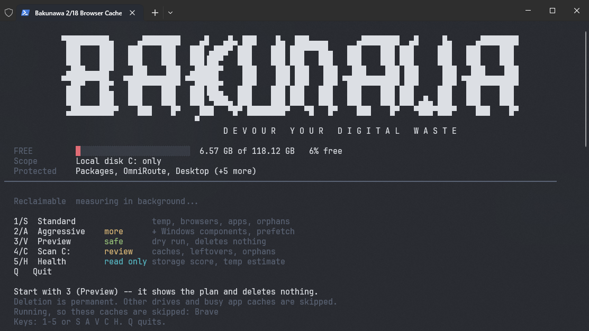

# Bakunawa



Windows PowerShell 5.1 cleaner for **local disk C: only**, with cleanup previews and application-aware cache and orphan review.

Run the existing menu:

```powershell
.\Bakunawa.ps1
```

Choose **3 — Preview** to inspect routine cleanup, or **4 — Scan C:** to discover and review candidates. Results show category totals and the largest findings first, with complete paths, sizes, age, and evidence. Use **N/P** to move between pages, item numbers to select candidates, **E** to export JSON, and **I** to inspect scan issues. Deleting a selection requires typing `DELETE`.

Deletion is permanent. There is no recovery copy — `Remove-ItemSafely` deletes directly and the space is reclaimed immediately. Use Preview before any Standard or Aggressive run.

Read-only command-line scan of C:\:

```powershell
.\Bakunawa.ps1 -Mode Scan -NoPause
```

Select a directory on C: and export a report:

```powershell
.\Bakunawa.ps1 -Mode Scan -ScanRoot 'C:\Users' -ReportPath '.\scan-report.json' -NoPause
```

Existing report files are preserved; choose a new filename for each export. Scan mode can run without elevation. Its coverage report identifies inaccessible locations. An administrator terminal can increase coverage.

## Scan progress and text logs

Every command-line run in **Standard, Aggressive, Scan, Health, or Benchmark** automatically writes a UTF-8 `.txt` log. Each non-Preview action selected from the interactive menu gets a separate log, including repeated scans. Preview writes only to the console, including when `-LogFile` is supplied, and creates no log or cache directories. Logs are stored at:

```text
%LOCALAPPDATA%\Bakunawa\Logs\yyyyMMdd-HHmmss-fff-Mode-uniqueId.txt
```

The terminal prints the full log path when the operation starts and ends. Existing automatic logs are never overwritten. `-LogFile 'C:\Reports\cleanup.txt'` appends an additional copy at your chosen path; it does not disable automatic logs. `-ReportPath` and the review's **E** command still create optional JSON reports.

Discovery shows preparation, the current root and path, elapsed time, observed traversal counts, provisional candidates, errors, and exclusions. It prints a persistent update approximately every five seconds while the walker returns entries, plus a completion line for each root. Counts marked `+` are lower bounds from the streaming walk; final file counts appear in the coverage report. An unknown tree size has no percentage or guessed completion time. Cleanup and benchmark progress tracks completed categories, whose running times can differ. `-NoAnimations` disables live progress overlays and retains the text updates.

The scan summary appears before detailed findings. It separates eligible orphans from candidates requiring review and calls out incomplete coverage. Command-line scans show up to ten largest candidates when the full report was successfully written; every encountered issue is printed. **Every finding, full path, reason, configured exclusion, and encountered issue remains in the text log.** Interactive review retains paging and item selection. Long paths wrap instead of being shortened, including in narrow terminals. Reports use text labels without emojis; the existing logo and menu remain.

See [the sample terminal report](docs/ui-report-example.txt) for the layout with candidates and a coverage gap.

Cleanup summaries distinguish preview estimates from permanently deleted data. Health and benchmark summaries describe estimates and timing; they do not claim complete filesystem coverage.

Logs are written during the operation. A failed or interrupted run retains the details already recorded. An `Interrupted` status or missing `RUN FINISHED` footer means the run is incomplete. If the log cannot be created, the operation does not start. A later write failure produces an explicit warning and an `INCOMPLETE` log message. Logs are retained until you remove them yourself and are excluded from normal drive discovery through the protected Bakunawa application directory. Preview creates no log and does not modify cleanup targets.

Preview routine cleanup without deleting, stopping services, or creating cache directories:

```powershell
.\Bakunawa.ps1 -Mode Preview -NoPause
```

## What scanning means

The scanner walks each selected tree once and aggregates file sizes and the newest modification time across descendants. Overlapping roots and nested findings are deduplicated. Progress reports the current path and elapsed time. There is no depth limit or silent time budget.

| Finding | Action |
| --- | --- |
| Known disposable cache directory matched to an application definition, including recently modified caches | Review-only without an accepted orphan rule; dedicated cache tasks may remove it |
| Stale files and folders inside known temp locations without an explicit orphan rule | Review-only in orphan discovery; dedicated temp-cache cleanup is separate |
| Old app-definition orphan with a recorded rule and all corroborating checks passed | Eligible after evidence and tree revalidation |
| Cache-like folders elsewhere, stale temporary files and logs | Review-only; no orphan cleanup without evidence |
| Stale app-data folders without a matching installed-app or process name | Possible leftovers; review required |
| Shortcuts with verified missing local targets on an available fixed drive | Review-only |
| Stale empty folders | Review required outside known temp locations |

Age and registry-name matching cannot prove that an item is unused. Portable apps, Store apps, and retained settings can lack a matching uninstall entry. Personal documents are not flagged merely because they are old. Files changed after a scan require another scan before removal.

Known cache detection reuses the application's cleanup definitions and requires a disposable cache name; it does not label entire installations as caches. Busy application cache paths are skipped and reported. Review checks running applications again before moving a selection. Minimum age still applies to name-only cache matches and possible leftovers.

Protected user folders, configured exclusions, Windows-managed directories, installed program roots, version-control metadata, junctions, symbolic links, and offline content are excluded from drive discovery. Each encountered exclusion or access error appears in the report. Dedicated cleanup tasks handle known Windows and application cache locations separately. An unavailable drive is reported as unavailable rather than empty.

## Cleanup

Routine cache cleanup preserves cache roots, processes siblings independently, and records locked-file failures. Installed SDKs, Python environments, and browser local storage are not routine cache targets. Running applications are checked against the application definitions. Preview totals are estimates; a successful run reports the bytes it permanently deleted.

Some locations hold install-staging leftovers beside files that must survive, so they are cleaned by name instead of by clearing the container. npm stages `.<name>-<8 chars>` entries in its prefix next to the shims that run it, and VS Code stages dot-prefixed directories and `*.vsctmp` tombstones inside `.vscode\extensions`. Those locations are declared with `mode: entry`, so only the matching entry is removed and the container and its siblings are left untouched. An entry newer than the configured age gate is skipped and reported rather than deleted, because an install may still be running. A missing location is reported as absent, not as an error.

The `AI Agent Caches` category covers agent and developer tool working directories. These locations are never emptied as containers. Cleanup targets only `*.tmp`, `*.log`, `*.bak`, `*.cache`, `*.blob`, and `*.sqlite-shm`/`*.sqlite-wal` entries, refuses any protected extension (`.json`, `.yaml`, `.yml`, `.env`, `.toml`, `.ini`, `.cfg`, `.conf`, `.config`), and requires a file to be older than three days (a positive `minAgeDays` on a definition location raises that guardrail for that location). An entry that fails any of those checks is recorded as skipped with a reason instead of deleted. A location that does not exist is reported as absent. Covered tools: 9Router, OmniRoute, MiMo Code, and Playwright MCP (stale `console-*.log` runs under `%USERPROFILE%\.playwright-mcp`; the `page-*.yml` snapshots are spared because `.yml` is a protected extension). Category estimates count only files that pass these guardrails, not whole directories.

Downloaded Playwright browser builds are cleared as `Browser Automation Caches`, but only the `chromium-<revision>` and `chromium_headless_shell-<revision>` directories. The shared `ms-playwright` parent's `ffmpeg`, `daemon`, and `winldd` folders are not targets, so media support and the driver survive; clearing the Chromium builds only costs a re-download. The definitions name those installs with a wildcard in the last path segment, which the loader resolves against the installed builds, so no revision is pinned.

Two `Dev Caches` targets are not cleared as containers. Maven's local repository (`.m2\repository`) is a dependency store used by offline builds: only `*.part` downloads and `*.lastUpdated` failure markers are removed, and only while no JVM is running. Bun's scratch `.bun-<pid>-<hash>.node`/`.dll` files in the temp root are matched by name and age while no `bun` process runs.

Electron and Chromium caches hold extensionless blobs (`data_0`, `f_000000`) that extension matching can never reach, so they are cleared as containers under `Dev Caches` instead, matching the existing Insomnia entries. `OpenChamber` contributes `Cache`, `Code Cache`, `GPUCache`, `DawnGraphiteCache`, `DawnWebGPUCache`, and `logs` — about 68 MB. Its `Partitions`, `Local Storage`, `Session Storage`, and `Network` directories hold live user state and are deliberately excluded. Because the definition names the `OpenChamber` process, a running app marks these paths busy and cleanup reports "close the owning app" instead of emptying them mid-write.

Not covered, and why: `~/.opencode` is your configuration and plugin checkout, not a cache. `~/.mcp` and `~/.mcp-hub` hold installed MCP servers and skills. `%LOCALAPPDATA%\ms-playwright-mcp` is 833 MB, but those are browser *profiles* — deleting them signs you out of everything — so only the Chromium caches inside them would qualify, not the profiles. `~/.cache/puppeteer` (705 MB) is a redownloadable browser cache, but purging it costs a full re-download, so it is left as an explicit choice. Bakunawa is C:-only by design, so OpenCode's relocated data directory on `D:` is out of reach. The live OmniRoute checkout under `%LOCALAPPDATA%\Temp\opencode\OmniRoute` is excluded from discovery and from parent sweeps because it is working session state, not a cache. npm, pip, pnpm, and Yarn caches are already covered by `Dev Caches`.

Scan roots outside C: are rejected, including saved configuration roots and network paths. Cleanup skips redirected locations outside C:, junctions, symbolic links, and offline paths. Wildcard expansion checks each directory before descending. Recycle Bin cleanup targets C: only. Event logs are retained because their storage can be redirected.

Deletion is permanent. `Remove-ItemSafely` re-validates each target immediately before deleting, then removes it and confirms it is gone. There is no recovery copy, so the freed space is reclaimed at once. Preview mode is the only dry run: it measures and reports the plan without touching the filesystem.

Configuration is loaded from `%APPDATA%\Bakunawa\config.json`, using defaults from `src/Bakunawa.Config.psm1`. The unused root `Bakunawa.json` has been removed. The `Orphan Scan` category is enabled in new defaults; an explicit setting in an existing user configuration takes precedence.

Optional scan settings in that configuration:

```json
"scanSettings": {
  "roots": ["C:\\"],
  "minAgeDays": 30,
  "aggressiveMinAgeDays": 14
}
```

An empty `roots` array selects C:\. `-ScanRoot` overrides configured roots but cannot expand the C: boundary. Remove other drives from older saved root lists before scanning. Custom exclusions belong in `exclusions.userCustomExclusions` or the `-ExtraExcludePath` argument.

## Verification

```powershell
Import-Module Pester -MinimumVersion 5.0
Invoke-Pester -Path .\tests -Output Detailed
```

The tests use temporary fixtures for deletion, preview immutability, and junction handling. No live drive cleanup is needed to run them.

## Evidence, coverage and run totals

See [the app-definition evidence schema](app-definitions/README.md) and [profile precedence](profiles/README.md). An explicitly supplied `-Mode` wins. Aggressive lowers the orphan age threshold (`scanSettings.aggressiveMinAgeDays`) and adds three Windows maintenance tasks on top of the Standard set: Prefetch, the font cache (event logs are retained), and DISM component-store cleanup. DISM is disabled by default because it can run for many minutes; enable the `DISM` task in `%APPDATA%\Bakunawa\config.json` to include it. Preview always plans Standard candidates and never runs these extras.

Scan and Preview stay unelevated. Every encountered denied or skipped path is reported with its reason; any skipped path makes discovery incomplete. JSON reports include `Status`, `IsComplete`, `RootsVisited`, `RootsSkipped`, `Coverage`, and `Issues`. Descendants of an inaccessible boundary cannot be enumerated and are not claimed as visited. Preview under different privileges can identify less than elevated Standard.

Preview and Standard first build the same candidate list under identical privileges and filesystem state. Standard then revalidates each candidate and processes it. Changed candidates, newly running owners, and protected locations are skipped. A failed action is reported rather than counted as success.

Run results expose `Candidates`, per-path `Outcomes`, and `CategoryReport`: identified bytes, acted-on bytes, unacted-on bytes by reason, and unknown-size path counts. Unknown sizes are never represented as measured zero. If a failed action cannot be remeasured, its acted-on and unacted-on category totals are unknown, `UnknownOutcomePaths` records the uncertainty, and confirmed byte totals are lower bounds. Preview has zero acted-on bytes. Every acted-on byte is permanently deleted and counts as freed space. No live cleanup is required to run the fixture acceptance tests.
