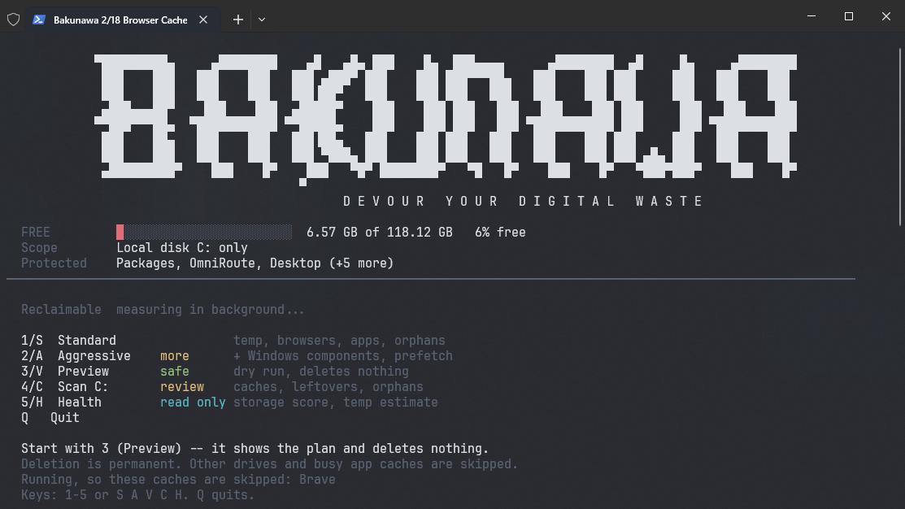
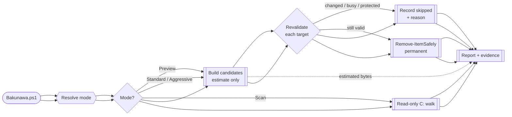
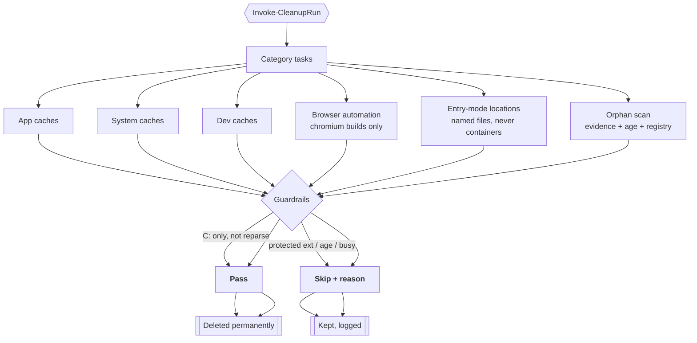
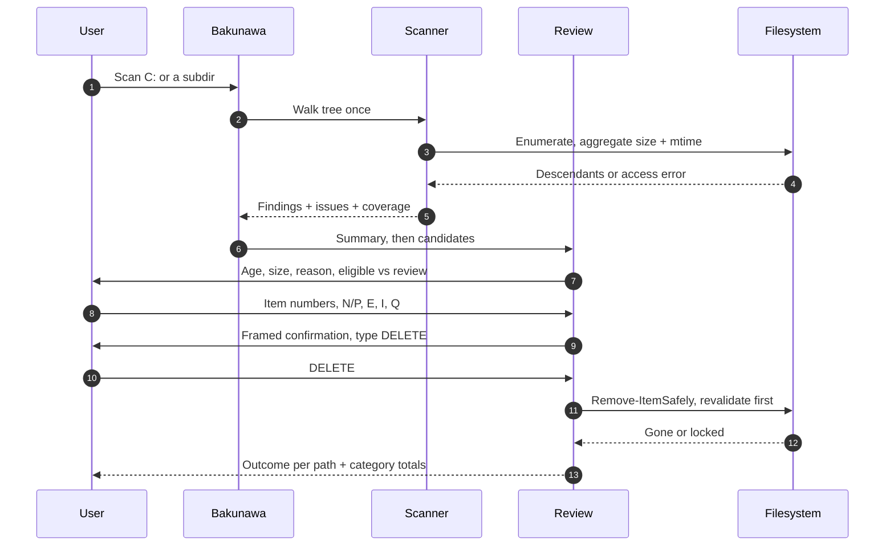
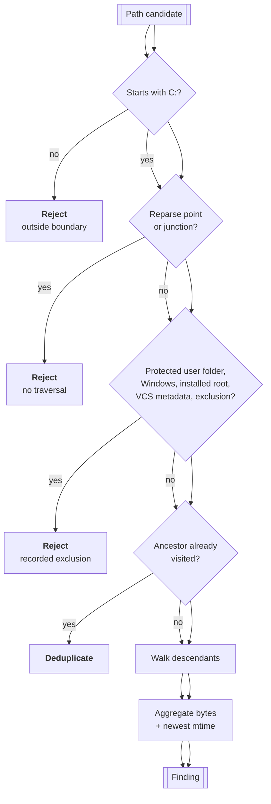

# Bakunawa

Windows PowerShell 5.1 cleaner for **local disk C: only**, with cleanup previews and application-aware cache and orphan review.

> **Nothing is deleted without a preview first.** Preview plans the same candidates Standard would act on and touches no file. Deletion is permanent: there is no recovery copy.

## How a run flows

*Edges animate where the renderer supports it (Mermaid 11.5+ or any viewer with the `animation` class applied); elsewhere the same diagram renders statically.*

## What cleanup touches

## Orphan review, step by step

## Discovery safety net

